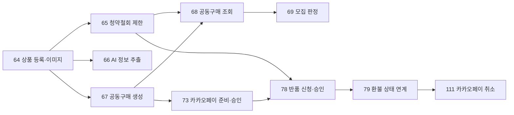
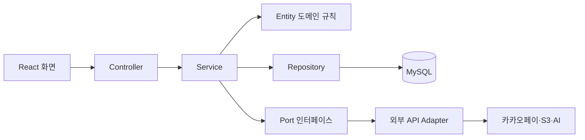
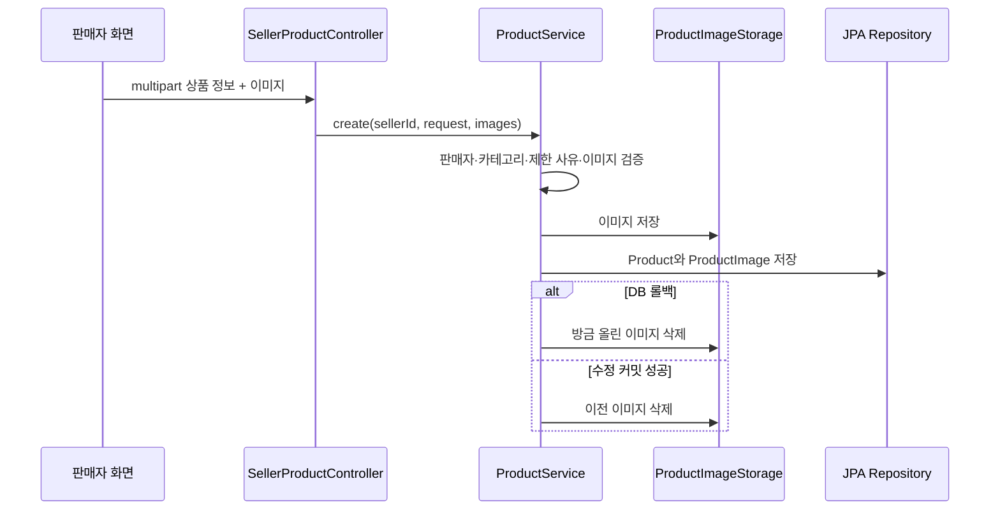
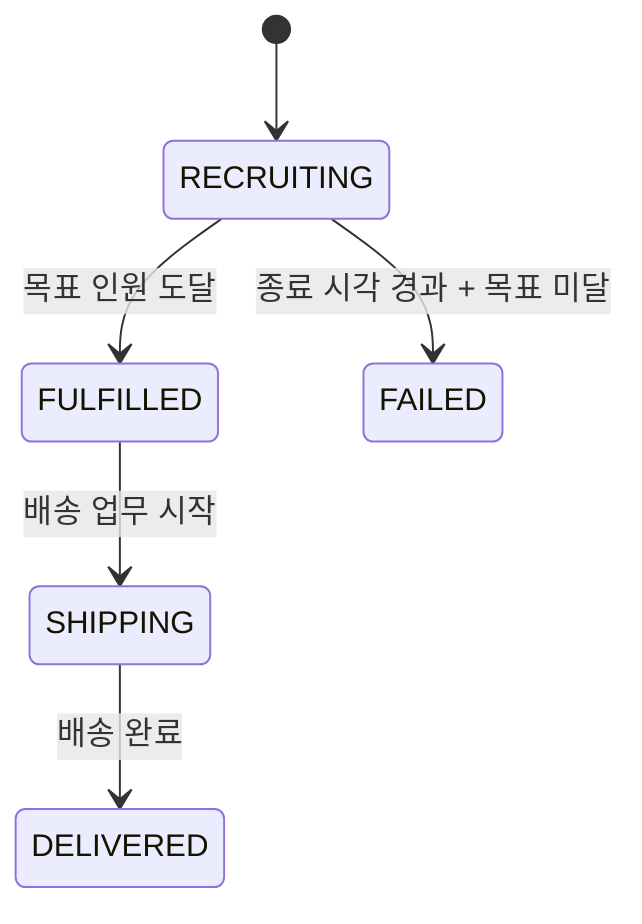
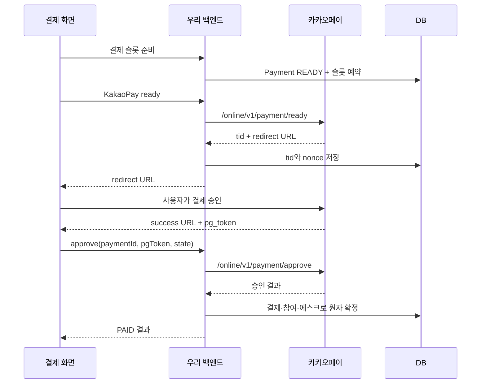
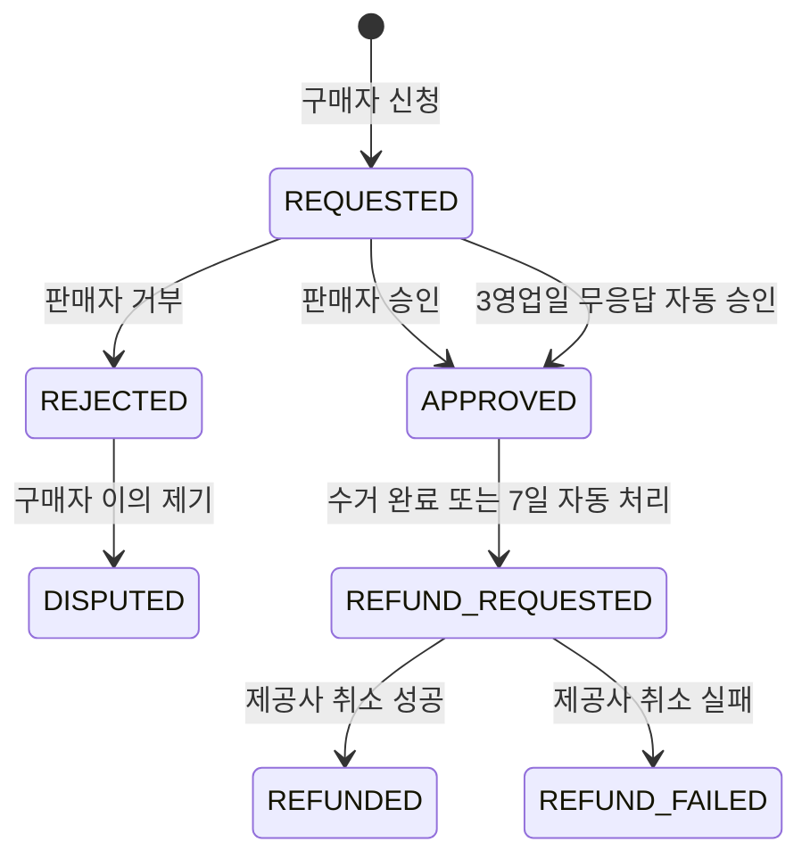
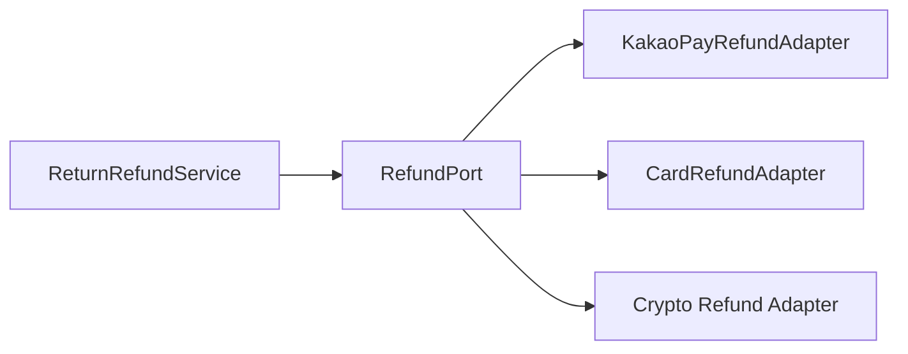
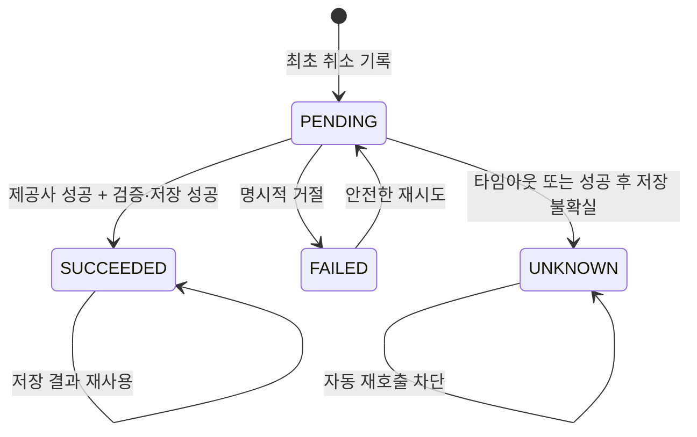

# 김태민 담당 MVP 구현 학습 가이드

> 대상 Jira: S15P21B205-64, 65, 66, 67, 68, 69, 73, 78, 79, 111
>
> 상위 스토리: S15P21B205-51(상품), 52(공동구매), 55(반품)
>
> 기준 브랜치: `DevelopV1`

이 문서는 작업 내역을 나열하는 완료 보고서가 아니다. 처음 프로젝트를 보는 개발자가 **어떤 문제를 왜 이렇게 풀었는지**, **요청 한 번이 어느 코드를 지나가는지**, **어떻게 검증하면 되는지**를 스스로 설명할 수 있게 만드는 학습용 문서다.

숨겨진 개인적 사고 과정을 그대로 옮기는 대신, 다른 개발자도 재현하고 검토할 수 있도록 각 판단을 다음 네 가지로 기록한다.

1. 맥락: 해결해야 했던 문제와 제약
2. 선택지: 실제로 고려할 수 있는 구현 방법
3. 결정: 채택한 방법과 버린 방법
4. 근거: 테스트, 데이터 일관성, 운영 위험으로 확인한 이유

---

## 1. 먼저 큰 그림 잡기

### 1.1 담당 기능의 의존 관계

기능을 독립적으로 나눴더라도 실제 실행 순서에는 의존성이 있다. 상품이 있어야 공동구매를 만들 수 있고, 공동구매와 결제 기록이 있어야 반품·환불을 검증할 수 있다.



이 순서대로 구현하면 공통 데이터 모델을 먼저 확정할 수 있어, 결제 담당자와 반품 담당자가 서로의 내부 코드를 기다리지 않고 DTO와 포트 계약을 기준으로 작업할 수 있다.

### 1.2 실제 요청이 지나가는 계층



- **Controller**: URL, 인증 사용자, 요청·응답 형식을 다룬다. 비즈니스 규칙을 직접 계산하지 않는다.
- **Service**: 하나의 사용자 목적, 즉 유스케이스를 조립한다. 트랜잭션 경계도 여기서 정한다.
- **Entity**: 상태가 바뀔 수 있는 조건을 객체 안에 보관한다.
- **Repository**: 데이터를 저장하고 조회한다. 쓰기는 JPA를 기본으로 하고, 복잡한 조회는 목적에 맞는 읽기 모델을 사용할 수 있다.
- **Port / Adapter**: 반품 도메인이 카카오페이나 카드의 상세 API를 직접 알지 않게 하는 경계다.

### 1.3 추천 학습 순서

1. 이 문서의 용어와 전체 흐름을 먼저 읽는다.
2. Controller에서 URL을 확인한다.
3. Service 메서드 한 개를 골라 성공 흐름을 따라간다.
4. Entity의 상태 전이 메서드와 Repository 쿼리를 확인한다.
5. 같은 이름의 테스트를 읽고 실패 조건을 확인한다.
6. 마지막으로 프론트 API 호출과 화면을 연결해 본다.

처음부터 모든 클래스를 읽는 것보다 `요청 → 서비스 → 상태 변경 → 응답` 한 줄을 끝까지 추적하는 편이 빠르다.

---

## 2. 꼭 알아야 할 용어

### JPA, JPQL, 변경 감지

- **JPA**는 자바 객체와 DB 테이블을 연결하는 표준이다.
- **Spring Data JPA Repository**는 `save`, `findById` 같은 공통 저장 기능과 메서드 이름 기반 조회를 제공한다.
- **JPQL**은 테이블이 아니라 엔티티와 필드를 대상으로 쓰는 조회 언어다.
- **변경 감지(dirty checking)**는 트랜잭션 안에서 조회한 엔티티의 필드가 바뀌면 JPA가 커밋 때 `UPDATE`를 만드는 기능이다.

따라서 서비스가 SQL 문자열로 상태를 바꾸기보다 `returnRequest.approve(...)`처럼 엔티티에 의도를 전달하면, 허용되는 상태 전이를 코드 한 곳에서 설명할 수 있다.

### 트랜잭션과 잠금

- **트랜잭션**은 여러 DB 변경을 모두 성공시키거나 모두 되돌리는 작업 단위다.
- **비관적 잠금(PESSIMISTIC_WRITE)**은 같은 행을 동시에 바꾸는 요청을 직렬화한다.
- 반품 중복 신청, 결제 중복 승인처럼 “조회한 뒤 변경”하는 로직은 조회 시점과 변경 시점 사이 경쟁을 막아야 한다.

### 멱등성

같은 요청을 두 번 보내도 결과가 한 번 보낸 것과 같아야 한다는 성질이다. 네트워크에서는 사용자가 버튼을 한 번 눌러도 타임아웃과 재시도로 동일 요청이 여러 번 도착할 수 있다. 환불은 두 번 실행되면 실제 금전 손실이 생기므로 `RETURN-{returnId}`를 멱등 키로 쓴다.

### CQRS 읽기 모델

쓰기 모델은 상태의 일관성과 도메인 규칙에 집중하고, 읽기 모델은 화면 한 장에 필요한 여러 테이블 데이터를 효율적으로 합치는 방식이다. 이 프로젝트는 모든 곳에 CQRS를 엄격히 적용하지는 않지만, 공동구매 검색처럼 복잡한 화면 조회에는 전용 SQL 읽기 모델을 둔다.

### Flyway

DB 구조 변경을 순서가 있는 SQL 파일로 관리하는 도구다. 이미 적용된 `V1__init_schema.sql`은 수정하지 않고, 새 구조는 다음 버전 마이그레이션으로 추가해야 팀원과 서버의 DB 이력이 일치한다.

### 스케줄러

사용자 요청 없이 정해진 주기로 실행되는 작업이다. 모집 종료 판정, 판매자 무응답 자동 승인, 수거 미확인 자동 환불에 사용된다. 후보를 조회하고 각 건을 처리하되 한 건의 실패가 다음 건을 막지 않도록 만드는 것이 중요하다.

---

## 3. 상품 도메인

### 3.1 S15P21B205-64: 상품 등록·수정·삭제와 이미지

#### 맥락

판매자는 공동구매를 열기 전에 상품과 이미지를 등록해야 한다. 이미지 저장소와 DB 저장 중 하나만 성공하면 고아 파일이나 깨진 상품이 남는다. 또한 다른 판매자의 상품 수정과 진행 중 공동구매에 연결된 상품 변경을 막아야 한다.

#### 구현 흐름



핵심 코드는 다음 순서로 읽는다.

- `SellerProductController`: `/sellers/products`
- `ProductService`: 소유권, 상태, 파일 부작용 조정
- `Product`, `ProductImage`: 상품과 이미지 관계
- `ProductImageStorage`, `S3ProductImageStorage`: 저장소 추상화와 실제 S3 구현
- `ProductRepository`: 상품 JPA 조회

#### 설계 판단

- 파일을 먼저 저장하고 DB가 실패하면 `afterCompletion`에서 새 파일을 지운다.
- 이미지 교체는 DB 커밋 후 기존 파일을 지운다. 먼저 지우면 DB 롤백 시 기존 상품 이미지까지 사라진다.
- 삭제는 실제 행 삭제가 아니라 상태를 바꾸는 soft delete다. 이미 생성된 주문과 감사 이력을 보존하기 위해서다.
- 진행 상태가 `RECRUITING`, `FULFILLED`, `SHIPPING`, `DELIVERED`인 공동구매가 있으면 상품 수정·삭제를 거부한다. 과거 결제의 상품 정보가 뒤늦게 바뀌는 일을 막는다.

#### 검증 포인트

- 다른 판매자의 상품에 접근하면 `RESOURCE_NOT_FOUND`
- 이미지가 없거나 대표 이미지 인덱스가 범위를 벗어나면 검증 오류
- S3 저장 중 일부 실패 시 이미 저장된 파일 정리
- DB 롤백 시 새 파일 정리, 정상 수정 커밋 후 이전 파일 정리

관련 테스트: `ProductServiceTest`, `S3ProductImageStorageTest`

### 3.2 S15P21B205-65: 청약철회 제한

#### 맥락과 결정

“반품 불가”는 판매자가 임의 문자열로 정하면 안 된다. 활성화된 제한 사유 마스터를 선택하고, 증빙이 필요한 사유는 URL을 제출하며, 관리자가 `PENDING → APPROVED/REJECTED`로 검토한다.

- 제한 사유가 없으면 일반 상품이다.
- 비활성 사유는 새 상품에 사용할 수 없다.
- 증빙 필수 사유인데 URL이 없으면 이미지 업로드 전에 거부한다.
- URL은 `http` 또는 `https`이며 실제 host가 있어야 한다.
- 승인·반려가 끝난 건을 다시 전이하지 않는다.

핵심 코드:

- `WithdrawalRestrictionReasonController`: 구매 가능한 제한 사유 목록
- `AdminProductController`: 관리자 검토 목록과 처리
- `WithdrawalRestrictionService`: 전이 규칙
- `RestrictionReviewStatus`: 문자열 대신 enum으로 가능한 상태 제한

이 값은 공동구매 상세와 반품 가능 여부 계산까지 전달된다. 즉 65번은 68번 조회와 78번 반품의 선행 계약이다.

관련 테스트: `WithdrawalRestrictionServiceTest`, `WithdrawalRestrictionIntegrationTest`

### 3.3 S15P21B205-66: AI 상품 정보 추출

#### 맥락과 결정

AI는 입력 편의 기능이지 상품 등록의 필수 인프라가 아니다. AI 서버 장애가 판매자의 수동 등록까지 막으면 핵심 기능이 부가 기능에 종속된다.

따라서 다음과 같이 격리했다.

1. 대표 이미지 한 장만 multipart로 AI 서버에 전달한다.
2. 결과를 상품 폼의 필드와 confidence로 변환한다.
3. 카테고리 이름은 DB의 실제 카테고리 ID로 매핑한다.
4. 일부 값만 있으면 `PARTIAL`, 필수 값까지 있으면 `COMPLETED`다.
5. 연결 실패·시간 초과·빈 결과는 예외로 상품 등록을 끝내지 않고 `FAILED`와 수동 입력 안내를 반환한다.

핵심 코드:

- `AiExtractionService`: 실패 격리와 결과 정규화
- `ProductExtractionClient`: 외부 AI 계약
- `FastApiProductExtractionClient`: multipart HTTP 구현과 timeout
- 프론트 `useAiExtraction`: 추출값을 폼에 제안하고 사용자가 최종 검수

관련 테스트: `AiExtractionServiceTest`, `FastApiProductExtractionClientTest`, `AiExtractionIntegrationTest`

---

## 4. 공동구매 도메인

### 4.1 S15P21B205-67: 생성과 금액 미리보기

#### 금액을 서버에서 다시 계산하는 이유

프론트가 보여 준 금액은 조작될 수 있고 버전 차이도 생긴다. 저장될 분담금·수수료·정산 예상액은 서버가 같은 공식으로 다시 계산해야 한다.

현재 공식은 다음과 같다.

- 1인 상품 분담금 = `ceil(상품 가격 / 목표 인원)`
- 반올림 차액 = `1인 분담금 × 목표 인원 - 상품 가격`
- 예상 플랫폼 수수료 = `floor(확정 분담금 합계 × 5%)`
- 예상 정산액 = `확정 분담금 합계 + 배송비 × 목표 인원 - 플랫폼 수수료`

`BigDecimal`과 명시적인 반올림 모드를 사용하는 이유는 부동소수점 오차와 개발자마다 다른 반올림 판단을 없애기 위해서다. `Math.multiplyExact`, `addExact`, `subtractExact`는 금액 범위 초과를 조용한 오버플로 대신 검증 오류로 바꾼다.

핵심 코드:

- `SellerGroupBuyController`: `/sellers/group-buys/preview`, `/sellers/group-buys`
- `GroupBuyService`: 소유 상품 검증, 모집 기간 검증, 서버 금액 계산
- `GroupBuyCommandRepository`: JPA 저장
- `GroupBuy.create`: 생성 시점 금액·정책 스냅샷

가격과 수수료를 생성 시점에 저장하는 이유는 이후 상품 가격이나 정책이 바뀌어도 이미 모집 중인 공동구매의 약속이 변하지 않아야 하기 때문이다.

### 4.2 S15P21B205-68: 공개·판매자 조회

구매자 목록은 키워드, 카테고리, 정렬, 페이지가 필요하고 카드 한 장에 상품·이미지·모집률·개인 결제 예정액이 함께 필요하다. 판매자 화면은 다시 참여자 현황까지 조회한다.

핵심 코드:

- `GroupBuyController`: `/group-buys`, `/group-buys/{groupBuyId}`
- `SellerGroupBuyQueryController`: `/sellers/group-buys`, `/{groupBuyId}/participants`
- `GroupBuyQueryService`: 입력과 접근 권한 검증
- `GroupBuyQueryRepository`: 화면 전용 projection SQL

여기서는 SQL을 의도적으로 남겼다. MySQL의 `MATCH ... AGAINST` 전문 검색, 여러 테이블 projection, 동적 정렬과 인덱스 실행 계획을 JPA 엔티티 그래프로 억지로 표현하면 다음 문제가 생긴다.

- 화면 한 장을 위해 불필요한 엔티티를 모두 로딩한다.
- N+1 조회나 큰 객체 그래프가 생길 수 있다.
- MySQL 전문 검색 기능을 잃거나 비효율적인 `LIKE '%검색어%'`로 후퇴한다.
- 쓰기 도메인 규칙과 화면 조립 책임이 섞인다.

즉 “JPA를 쓰는 프로젝트”는 SQL 문자열이 절대로 없어야 한다는 뜻이 아니다. **상태 변경은 엔티티와 JPA로 관리하고, DB 고유 기능이 필요한 복잡한 읽기는 테스트된 전용 조회로 격리한다**는 것이 이 프로젝트의 기준이다.

관련 테스트: `GroupBuyQueryServiceTest`, `GroupBuyQueryIntegrationTest`, `SellerGroupBuyIntegrationTest`

### 4.3 S15P21B205-69: 모집 성공·실패 자동 판정



목표 인원 도달은 결제 완료 직후 즉시 판정하고, 시간 종료 건은 스케줄러가 최대 500개씩 조회해 판정한다. 성공 시 영업일 기준 배송 마감 시각을 계산하고 `GroupBuyFulfilledEvent`, 실패 시 `GroupBuyFailedEvent`를 발행한다.

이벤트를 쓰는 이유는 모집 상태 변경을 중심에 두고, 후속 알림·환불·판매자 업무를 다른 담당자가 독립적으로 구독하게 하기 위해서다. 모집 서비스가 모든 후속 도메인의 Repository를 직접 호출하면 작은 변경에도 서로 충돌한다.

핵심 코드:

- `GroupBuyRecruitmentService`: 판정 유스케이스
- `GroupBuy.judgeRecruitment`: 상태 전이 규칙
- `GroupBuyRecruitmentScheduler`: 주기 실행
- `BusinessDayCalculator`, `PolicyService`: 배송 마감 정책

관련 테스트: `GroupBuyRecruitmentIntegrationTest`, `BusinessDayCalculatorTest`

---

## 5. S15P21B205-73: 카카오페이 준비와 승인

### 5.1 전체 흐름



### 5.2 중요한 보안·일관성 판단

- 브라우저에서 돌아오는 `paymentId`만 믿지 않는다.
- `state`에 payment ID, user ID, 만료 시각, 일회용 nonce를 담고 서버 비밀키로 HMAC 서명한다.
- 승인 전에 내부 Payment 금액과 Ready 때 저장한 금액을 다시 대조한다.
- 카카오 승인 응답의 tid, 주문 ID, 사용자 ID, 금액도 다시 검증한다.
- 최종 결제·참여·에스크로 상태는 짧은 단일 DB 트랜잭션으로 확정한다.
- 이미 완료된 nonce 재요청은 카카오 API를 다시 부르지 않고 저장된 결제 결과를 반환한다.

### 5.3 외부 HTTP 호출 중 트랜잭션을 열지 않는 이유

외부 API는 수 초 동안 느려지거나 타임아웃될 수 있다. 이 동안 DB 트랜잭션과 행 잠금을 유지하면 다른 결제 요청이 대기하고 커넥션 풀이 고갈된다.

따라서 흐름을 나눈다.

1. 짧은 DB 조회/준비
2. 트랜잭션 밖 카카오 HTTP 호출
3. 짧은 DB 재검증/확정

중간에 슬롯 상태가 바뀔 수 있으므로 외부 호출 뒤에도 내부 상태를 반드시 재검증한다.

### 5.4 cancel URL과 결제 취소 API는 다르다

- **cancel URL**: 사용자가 카카오 결제 화면에서 결제를 중단했을 때 돌아오는 브라우저 주소다. 아직 승인된 돈을 환불하는 API가 아니다.
- **결제 취소 API**: 이미 승인된 결제의 전액 또는 일부 금액을 실제로 취소한다. 111번 기능이다.

핵심 코드:

- 프론트 `PaymentPage`, `KakaoPayCallbackPage`
- `KakaoPayController`
- `KakaoPayService`
- `KakaoPayStateSigner`
- `HttpKakaoPayGateway`
- `KakaoPayRecordService`

관련 테스트: `KakaoPayStateSignerTest`, `HttpKakaoPayGatewayTest`, `KakaoPayServiceTest`, `KakaoPayCompletionIntegrationTest`

### 5.5 결제와 에스크로의 실제 연결

`PaymentService.completePayment`는 결제만 `PAID`로 바꾸지 않는다. 같은 트랜잭션에서 공동구매 슬롯을 확정하고, 참여 건을 만든 다음, 에스크로를 `HELD`로 만든 뒤 결제에 participation ID를 연결한다.

결제 공통 패키지는 `EscrowRepository`를 직접 참조하지 않고 `EscrowWriterPort`만 호출한다. 운영용 `EscrowWriterAdapter`가 이 명령을 `Escrow.hold`와 JPA `save`로 변환한다.

초기 통합 상태에는 테스트 프로필 전용 어댑터만 있고 운영 어댑터가 없어, 단위·Spring 테스트는 통과하지만 실제 `bootRun`은 `No qualifying bean of type EscrowWriterPort`로 실패했다. 해결할 때 테스트용 구현을 운영 코드로 단순 복사해 두 벌로 유지하지 않았다.

1. 포트가 요구하는 입력과 기존 `Escrow.hold` 팩터리의 필드를 대조했다.
2. `src/main`에 운영 어댑터를 추가했다.
3. `src/test` 임시 어댑터를 제거해 테스트도 운영 어댑터를 사용하게 했다.
4. 어댑터 단위 테스트에서 participation, group buy, 금액, 보관 시각, `HELD` 상태가 그대로 저장되는지 확인했다.
5. 실제 MySQL과 전체 애플리케이션 컨텍스트를 다시 기동해 빈 연결을 검증했다.

이 사례는 “테스트가 통과했다”와 “운영 프로필로 애플리케이션이 뜬다”가 다른 검증이라는 점을 보여 준다. 테스트 fixture가 운영 의존성 누락을 가릴 수 있으므로 제출 전 실제 프로필 기동 검사가 필요하다.

---

## 6. S15P21B205-78: 반품 신청·승인

### 6.1 반품 가능 여부

`ReturnRequestService`가 다음 순서로 판단한다.

1. 사유는 `CHANGE_OF_MIND` 또는 `DEFECT`인가?
2. 해당 참여 건의 구매자인가?
3. 상태가 `DELIVERED` 또는 `CONFIRMED`인가?
4. 청약철회 기한 안인가?
5. 구매확정 건이라면 아직 정산 대상 시각 전인가?
6. 청약철회 제한 상품이면 하자 사유인가?
7. 이미 구매확정 hold 또는 진행 중 반품이 있는가?

미리보기와 실제 신청은 같은 계산 함수를 사용한다. 단, 실제 신청은 참여 행을 잠그고 다시 검증한다. 화면에서 미리 본 뒤 다른 요청이 먼저 신청할 수 있기 때문이다.

### 6.2 금액 예제로 이해하기

가정:

- 총 결제액: 53,000원
- 상품 분담금: 50,000원
- 최초 배송비: 3,000원
- 반품 배송비: 6,000원

단순 변심은 구매자가 반품 배송비를 부담하고 최초 배송비를 환불받지 않는다.

```text
환불액 = 상품 분담금 - 반품 배송비
       = 50,000 - 6,000
       = 44,000원
```

하자 반품은 판매자 귀책이므로 구매자에게 총 결제액을 환불한다.

```text
환불액 = 총 결제액 = 53,000원
반품 배송비 부담자 = 판매자
```

금액을 신청 시점의 `return_requests`에 저장하는 이유는 상품 가격이나 정책이 나중에 바뀌어도 이미 접수된 환불액이 변하지 않게 하기 위해서다.

### 6.3 상태 흐름



구매확정 뒤 들어온 신청은 무조건 자동 승인하지 않고 `adminReviewRequired`로 분리한다. 이미 정산 흐름과 충돌할 가능성이 있어 사람의 검토가 필요하기 때문이다.

### 6.4 동시성 처리

신청할 때 `Participation` 행을 비관적 잠금으로 조회한다. 두 요청이 동시에 `existsOpenReturn == false`를 읽고 각각 생성하는 경쟁을 막는다. 상태 변경 이력은 `ReturnRequestHistory`에 별도로 남겨 현재 상태뿐 아니라 어떤 이유로 언제 바뀌었는지도 확인할 수 있다.

핵심 코드:

- `BuyerReturnController`: 미리보기, 신청, 목록, 상세, 이의 제기
- `SellerReturnController`: 목록, 승인, 거부, 수거 완료
- `ReturnRequestService`: 자격·금액·상태 정책
- `ReturnRequest`: JPA 상태 전이
- `ReturnRequestRepository`: JPA facade와 projection
- `ReturnAutoApprovalScheduler`: 무응답 자동 승인

관련 테스트: `ReturnRequestServiceTest`, `ReturnBusinessDayCalculatorTest`, `ReturnRequestRepositoryTest`

---

## 7. S15P21B205-79: 반품과 결제수단별 환불 연결

반품 도메인이 `KakaoPayService`, 카드 서비스, 코인 서비스를 직접 참조하면 새 결제수단이 생길 때마다 반품 코드를 수정해야 한다. 이를 피하려고 `RefundPort`라는 공통 계약을 만들었다.



`ReturnRefundService`는 결제수단 문자열을 지원하는 어댑터를 찾고, 다음 공통 값만 전달한다.

- 멱등 키
- 반품 ID
- 원 결제 ID
- 결제수단
- 서버가 확정한 환불액

판매자가 수거 완료를 누르거나 승인 후 7일이 지나면 `APPROVED → REFUND_REQUESTED`로 바꾼 뒤 외부 환불을 요청한다. 성공하면 참여 상태와 구매확정 hold를 함께 정리한다. 7일 자동 환불은 `ReturnNeglectEvent`도 발행해 판매자 패널티 기능이 독립적으로 연결될 수 있게 했다.

### 트랜잭션 분리

`ReturnRefundRecordService`가 `REQUIRES_NEW`로 외부 호출 전후의 짧은 기록 트랜잭션을 담당한다.

```text
prepare(REQUIRES_NEW) → 외부 환불 호출(트랜잭션 없음) → complete/fail(REQUIRES_NEW)
```

이렇게 해야 느린 외부 호출 동안 반품 행 잠금과 DB 커넥션을 잡고 있지 않는다. 외부 호출이 실패해도 `REFUND_FAILED` 이력이 별도 트랜잭션으로 남는다.

관련 테스트: `ReturnRefundServiceTest`, `ReturnRefundRecordServiceTest`

---

## 8. S15P21B205-111: 카카오페이 전액·부분 취소

`KakaoPayRefundAdapter`는 `RefundPort`를 카카오페이 `/online/v1/payment/cancel` 요청으로 번역한다. 원 승인 거래의 `tid`와 반품에서 확정한 금액을 사용하고 응답 금액을 다시 검증한다.

### 8.1 취소 멱등 상태



- `SUCCEEDED`: 같은 키의 중복 요청은 저장된 cancel aid를 반환한다.
- `FAILED`: 제공사가 명시적으로 거절해 취소되지 않았음을 아는 경우에만 재시도할 수 있다.
- `UNKNOWN`: 타임아웃처럼 제공사에서 실제 취소됐는지 모르는 상태다. 자동 재호출하면 이중 취소 위험이 있으므로 운영자가 결과를 확인해야 한다.
- 동일 멱등 키를 다른 결제나 다른 금액에 재사용하면 즉시 거부한다.

외부 제공사는 성공했지만 우리 DB의 응답 검증·저장이 실패한 경우도 `UNKNOWN`으로 남긴다. “로컬 저장 실패 = 외부 취소 실패”가 아니기 때문이다.

핵심 코드:

- `KakaoPayRefundAdapter`: 공통 환불 요청 변환
- `KakaoPayCancellationRecordService`: 호출 전후 짧은 트랜잭션
- `KakaoPayCancellation`: 멱등 상태 엔티티
- `HttpKakaoPayGateway`: 실제 cancel HTTP 계약

관련 테스트: `KakaoPayRefundAdapterTest`, `KakaoPayCancellationRecordServiceTest`, `KakaoPayCancellationTest`, `HttpKakaoPayGatewayTest`

---

## 9. JPA 전환과 SQL 감사 결과

### 9.1 무엇을 바꿨는가

MVP 후 전체 코드 리뷰에서 “JPA 프로젝트인데 Repository에 SQL이 왜 있는가”를 기능별로 분류했다.

| 영역 | 이전 | 현재 | 판단 |
| --- | --- | --- | --- |
| 반품 쓰기·상태 전이 | `NamedParameterJdbcTemplate` 중심 | `ReturnRequest`, `ReturnRequestHistory` JPA 엔티티와 JPA Repository | 상태 규칙과 잠금을 객체·트랜잭션으로 모음 |
| 공동구매 생성 | 직접 `INSERT`와 생성키 재조회 | `GroupBuy.create` + JPA `save` | 생성 스냅샷과 기본값 책임을 엔티티에 모음 |
| 상품 판매자/활성 공구 확인 | ProductRepository native query | `SellerProfileRepository`, `GroupBuyRepository` 책임별 JPA 조회 | 다른 도메인 테이블 지식을 ProductRepository에서 제거 |
| 공동구매 공개 조회 | 전용 JDBC SQL | 유지 | MySQL 전문검색·projection·정렬·인덱스 목적의 읽기 모델 |
| 참여 목록 조회 | 전용 JDBC SQL | 유지 | 여러 화면 필드를 한 번에 만드는 읽기 projection이며 타 담당자 영역 |

### 9.2 처음부터 전부 JPA 연관관계로 묶지 않은 이유

리팩터링 중 반품 엔티티에 필요 이상의 타 도메인 연관관계를 추가하자 H2가 FK를 자동 생성했고, 다른 기능의 독립 테스트 fixture가 깨졌다. 운영 DB에 이미 존재하는 관계라고 해서 모든 관계를 JPA 객체 그래프로 강제할 필요는 없다.

최종 원칙은 다음과 같다.

- 상태 전이에 꼭 필요한 소유 관계만 엔티티 연관으로 둔다.
- 다른 aggregate의 데이터는 ID와 해당 도메인 Repository로 조회한다.
- 화면 조립용 다중 테이블 조회는 읽기 Repository에 격리한다.
- native/JDBC SQL을 남길 때는 DB 고유 기능 또는 측정 가능한 조회 이점과 통합 테스트가 있어야 한다.

### 9.3 충돌 해결 원칙

최신 `DevelopV1`을 반영하는 과정에서 다른 담당자가 `Participation`에 배송·구매확정 기능을 추가한 변경과 반품 잠금 변경이 충돌했다. 이때 두 구현을 복사해 모두 남기지 않았다.

1. 원격 `DevelopV1`의 최신 배송·구매확정 구현을 기준으로 살렸다.
2. 그 구조 위에 반품에 필요한 상태 상수, hold 해제, 잠금 조회만 다시 적용했다.
3. 관련 도메인과 전체 회귀 테스트로 양쪽 기능이 함께 동작하는지 확인했다.

같은 책임의 코드를 두 벌 유지하면 지금 충돌은 피할 수 있어도 다음 수정부터 분기가 달라진다. “원격 최신 구현을 살리고 내 기능을 재적용한다”는 원칙은 코드 길이와 장기 유지비를 줄인다.

---

## 10. 설정과 비밀정보

외부 API 키는 프론트 번들, Git 커밋, 문서, 로그에 넣지 않는다. 로컬에서는 `backend/.env`의 다음 환경 변수 이름으로만 관리한다.

- `SSAFY_API_KEY`: SSAFY 교육용 금융망 연동
- `KAKAOPAY_SECRET_KEY`: 카카오페이 개발용 Secret Key

값 자체는 서버에서만 읽고, 저장소에는 예시 이름과 빈 값만 둔다. 키가 노출되면 새 키로 교체하고 Git 이력에서도 제거해야 한다. 카카오페이 Ready/Approve/Cancel 인증 헤더는 `HttpKakaoPayGateway`가 서버 측에서 구성한다.

---

## 11. 테스트로 코드를 공부하는 법

### 11.1 테스트 층별 의미

- **단위 테스트**: Service나 Entity 한 개의 분기와 계산을 빠르게 검증한다.
- **Repository 통합 테스트**: 실제 JPA 매핑, JPQL, 잠금, DB 제약을 H2 컨텍스트에서 검증한다.
- **HTTP 계약 테스트**: 외부 API URL, 헤더, JSON 필드와 오류 변환을 검증한다.
- **기능 통합 테스트**: 결제 승인처럼 여러 테이블이 함께 바뀌는지 확인한다.
- **전체 회귀 테스트**: 내 기능 수정이 다른 담당자의 기능을 깨뜨리지 않았는지 확인한다.

### 11.2 실행 명령

Windows PowerShell 기준이다.

```powershell
cd backend
.\gradlew.bat clean test
```

특정 테스트만 빠르게 반복할 때는 다음처럼 실행한다.

```powershell
.\gradlew.bat test --tests "com.gongguhan.domain.returnrequest.*"
.\gradlew.bat test --tests "com.gongguhan.domain.payment.kakaopay.*"
```

프론트 정적 검증은 다음 세 단계를 모두 통과해야 한다.

```powershell
cd frontend
npm run typecheck
npm run lint
npm run build
```

카테고리 기준과 상품 상세 API까지 반영한 최신 기준 백엔드는 310개 중 307개가 통과했다. 실패 3개는 코드 assertion 실패가 아니라 로컬 Redis가 떠 있지 않아 연결이 거부된 테스트다.

- `GroupBuySlotGateIntegrationTest` 2개
- `PaymentServiceConcurrencyTest` 1개

이 세 테스트까지 포함한 완전한 회귀 결과를 얻으려면 먼저 프로젝트 설정과 같은 Redis를 실행한 뒤 전체 테스트를 다시 수행해야 한다. Redis 없이 307개가 통과했다는 결과를 310개 전체 통과라고 표현하면 안 된다.

### 11.3 테스트를 읽을 때 질문할 것

1. Given: 어떤 DB 상태와 시간이 준비됐는가?
2. When: 어떤 사용자 요청을 실행하는가?
3. Then: 응답뿐 아니라 어떤 상태·이력·외부 호출 횟수를 확인하는가?
4. 실패 테스트는 어떤 위험을 막기 위해 존재하는가?
5. 동일 요청을 두 번 보냈을 때도 안전한가?

---

## 12. 직접 눌러보는 MVP 점검표

### 상품

- [ ] 판매자 상품 등록 시 여러 이미지와 대표 이미지가 저장된다.
- [ ] AI 추출 성공 시 필드가 제안되고 판매자가 수정할 수 있다.
- [ ] AI 서버 실패 시 수동 입력으로 계속 등록할 수 있다.
- [ ] 증빙 필수 청약철회 제한 사유에 URL이 없으면 등록되지 않는다.
- [ ] 진행 중 공동구매가 연결된 상품은 수정·삭제되지 않는다.
- [ ] 다른 판매자의 상품을 수정할 수 없다.

### 공동구매

- [ ] 금액 미리보기와 생성 후 서버 금액이 일치한다.
- [ ] 모집 종료가 시작보다 빠르면 생성되지 않는다.
- [ ] 검색어·카테고리·정렬·페이지 이동이 함께 동작한다.
- [ ] 상세의 모집률과 개인 결제 예정액이 서버 응답과 같다.
- [ ] 목표 인원 도달 시 `FULFILLED`로 바뀐다.
- [ ] 마감 후 목표 미달이면 `FAILED`로 바뀐다.

### 카카오페이

- [ ] 준비 후 카카오 결제창으로 이동한다.
- [ ] 성공 콜백은 approve를 호출하고 결제 완료 화면으로 이동한다.
- [ ] 사용자 취소와 인증 실패 콜백은 내부 슬롯을 정상 해제한다.
- [ ] 성공 콜백을 새로고침해도 외부 승인이 중복 실행되지 않는다.
- [ ] 만료되거나 변조된 state는 거부된다.
- [ ] 결제 완료 뒤 참여와 에스크로도 함께 확정된다.

### 반품·환불

- [ ] 단순 변심과 하자의 미리보기 환불액·부담자가 다르다.
- [ ] 배송 완료 전, 기한 경과, 제한 상품의 단순 변심은 신청되지 않는다.
- [ ] 동시에 두 번 신청해도 진행 중 반품은 하나만 생성된다.
- [ ] 판매자가 승인·거부할 수 있고, 거부 후 구매자가 이의를 제기할 수 있다.
- [ ] 판매자 3영업일 무응답 시 자동 승인된다.
- [ ] 수거 완료 시 결제수단에 맞는 환불 어댑터가 호출된다.
- [ ] 승인 후 7일 수거 미확인 시 자동 환불과 neglect 이벤트가 발생한다.
- [ ] 동일 반품 환불을 재시도해도 카카오 취소가 이중 실행되지 않는다.
- [ ] 결과 불명(`UNKNOWN`)인 취소는 자동 재호출되지 않는다.

---

## 13. 코드 리뷰 체크리스트

- [ ] Controller에 금액 계산이나 상태 전이 로직이 들어가지 않았는가?
- [ ] 서버가 프론트에서 받은 가격·사용자·상태를 그대로 신뢰하지 않는가?
- [ ] 상태 변경 조건이 Entity 또는 한 Service에 모여 있는가?
- [ ] 외부 HTTP 호출 동안 DB 트랜잭션이나 행 잠금을 유지하지 않는가?
- [ ] 재시도 가능한 API에 멱등성 전략이 있는가?
- [ ] 실패 후 상태와 이력이 운영자가 이해할 수 있게 남는가?
- [ ] 다른 담당자 도메인을 직접 참조하지 않고 Port나 이벤트 경계가 필요한가?
- [ ] native/JDBC SQL은 읽기 목적과 테스트 근거가 있는가?
- [ ] 새 JPA 연관관계가 다른 도메인 테스트 fixture에 불필요한 FK를 강제하지 않는가?
- [ ] 키·토큰·개인정보가 로그, 문서, 커밋에 포함되지 않았는가?
- [ ] 단위·통합·전체 회귀 결과를 구분해 기록했는가?

---

## 14. 알려진 한계와 다음 개선 후보

- 로컬 Redis가 없는 환경에서는 슬롯·결제 동시성 통합 테스트 3개를 실행할 수 없다. 제출 전 Redis가 있는 환경에서 310개 전체 재검증이 필요하다.
- `GroupBuyQueryRepository`는 MySQL 전문 검색에 의존하므로 H2 테스트만으로 운영 실행 계획을 완전히 보장하지 못한다. MySQL 기반 통합 또는 Testcontainers 테스트를 추가하면 더 안전하다.
- 환불 `UNKNOWN`은 이중 취소를 막지만 자동 복구하지 않는다. 운영자 조회·대사(reconciliation) 화면이나 제공사 상태 조회 배치가 후속으로 필요하다.
- 영업일 계산은 현재 주말을 중심으로 한다. 실제 운영에서는 공휴일 캘린더 정책을 연결해야 한다.
- 외부 S3·AI·카카오페이 개발 환경까지 포함한 E2E는 키, 네트워크, 테스트 계정 상태에 좌우된다. mock 통과와 실제 샌드박스 통과를 구분해 기록해야 한다.

---

## 15. Jira와 Merge Request 추적표

| Jira | 기능 | 주요 MR |
| --- | --- | --- |
| S15P21B205-64 | 상품 등록·이미지/S3 | !11, !14 |
| S15P21B205-65 | 청약철회 제한 검토 | !39 |
| S15P21B205-66 | AI 상품정보 추출 | !40 |
| S15P21B205-67 | 공동구매 생성·미리보기 | !15 |
| S15P21B205-68 | 공동구매 공개·판매자 조회 | !17 |
| S15P21B205-69 | 모집 성공·실패 판정 | !28 |
| S15P21B205-73 | 카카오페이 Ready/Approve | !49 |
| S15P21B205-78 | 반품 신청·승인 및 FE 계약 | !51, !52 |
| S15P21B205-79 | 반품 환불 상태 연계 | !59 |
| S15P21B205-111 | 카카오페이 취소 어댑터 | !60 |
| S15P21B205-55 | 반품 저장 계층 JPA 전환 | !63 |
| S15P21B205-52 | 공동구매 생성 저장 JPA 전환 | !64 |
| S15P21B205-51 | 상품 정책 조회 JPA 책임 분리 | !66 |

MR과 커밋 설명에는 요구사항만 쓰지 않고 다음을 함께 남겼다.

- 어떤 문제를 해결했는지
- 상태와 데이터가 어떻게 바뀌는지
- 리팩터링한 이유와 경계 선택
- 어떤 테스트를 통과했는지
- 실행 환경 때문에 검증하지 못한 항목

AI 도구의 공동 작성자 표시는 커밋에 넣지 않는다. 코드의 책임과 검토 책임은 커밋 작성자와 팀에게 있다.

---

## 16. 이 문서를 다 읽은 뒤 스스로 답해 볼 질문

1. 왜 공동구매의 개인 결제 금액을 프론트가 아니라 서버가 확정해야 하는가?
2. 왜 AI 서버 장애가 상품 등록 실패로 이어지면 안 되는가?
3. 왜 카카오페이 승인 HTTP 호출을 DB 트랜잭션 안에서 하면 위험한가?
4. cancel URL과 결제 취소 API의 차이는 무엇인가?
5. 왜 반품 미리보기 후 실제 신청 때 자격을 다시 검사하고 행을 잠가야 하는가?
6. 왜 타임아웃된 취소를 `FAILED`가 아니라 `UNKNOWN`으로 구분하는가?
7. JPA 프로젝트에서 `GroupBuyQueryRepository`의 SQL을 남긴 근거는 무엇인가?
8. 왜 다른 도메인의 모든 FK를 JPA 연관관계로 매핑하지 않았는가?
9. 충돌 때 두 구현을 합쳐 남기지 않고 원격 구현 위에 재적용한 이유는 무엇인가?
10. 307개 통과·3개 Redis 실패를 “전체 테스트 통과”라고 부르면 왜 안 되는가?

이 질문에 코드 위치와 테스트 이름을 근거로 답할 수 있다면, 단순히 기능 사용법을 아는 수준을 넘어 현재 설계를 리뷰하고 다음 기능을 안전하게 확장할 준비가 된 것이다.

---

## 17. 파일을 실제로 따라 읽는 상세 코드 투어

이 장은 앞 장의 개념을 실제 코드와 연결한다. IDE에서 아래 링크를 순서대로 열고, 설명에 나온 메서드를 찾는다. 코드를 외우는 것이 목적이 아니라 **각 계층이 무엇을 알고 무엇을 모르는지** 구분하는 것이 목적이다.

### 17.1 상품 등록 한 건을 끝까지 추적하기

#### 1단계: HTTP 입력 경계

[`SellerProductController`](../../backend/src/main/java/com/gongguhan/domain/product/controller/SellerProductController.java)의 `create`를 연다.

요청은 `multipart/form-data`이고 두 부분으로 나뉜다.

- `product`: JSON 형식의 `ProductUpsertRequest`
- `images`: 하나 이상의 이미지 파일

`@AuthenticationPrincipal Long sellerId`는 요청 본문의 판매자 ID를 믿지 않고 인증 결과에서 사용자를 얻는다는 뜻이다. 악의적인 사용자가 JSON에 다른 판매자 ID를 넣어도 Controller 계약상 받을 자리가 없다.

[`ProductUpsertRequest`](../../backend/src/main/java/com/gongguhan/domain/product/dto/ProductUpsertRequest.java)의 필드별 역할은 다음과 같다.

| 필드 | 검증 | 사용 이유 |
| --- | --- | --- |
| `categoryId` | null 불가 | DB에 존재하는 카테고리와 연결 |
| `name` | 공백 불가, 최대 200자 | 상품 표시명 |
| `brand` | 최대 100자 | 선택 입력 |
| `modelName` | 최대 100자 | 선택 입력 |
| `color` | 최대 50자 | 선택 입력 |
| `description` | 선택 | 상세 설명 |
| `price` | 0보다 큼 | 공동구매 분담금의 원금 |
| `thumbnailIndex` | 0 이상 | images 중 대표 이미지 위치 |
| `aiExtracted` | boolean | 최종 입력에 AI 제안을 사용했는지 기록 |
| `withdrawalRestrictionReasonId` | 선택 | 제한 사유 마스터 참조 |
| `restrictionEvidenceUrl` | 최대 500자 | 제한 사유 증빙 |

DTO 검증은 문자열 길이와 기본 형식을 빠르게 거른다. 하지만 “현재 판매자가 사용 가능한가”, “카테고리가 실제 존재하는가”, “해당 제한 사유가 활성 상태인가”는 DB 상태가 필요한 비즈니스 검증이므로 Service가 맡는다.

#### 2단계: 서비스 검증 순서

[`ProductService`](../../backend/src/main/java/com/gongguhan/domain/product/service/ProductService.java)의 `create`는 다음 순서를 지킨다.

1. `ensureUsableSeller`: 판매자 상태가 `ACTIVE` 또는 `WARNED`인지 확인한다.
2. `findCategory`: 요청한 카테고리가 존재하는지 확인한다.
3. `validateImages`: 이미지 존재 여부와 대표 인덱스를 검사한다.
4. `findRestrictionReason`: 제한 사유·증빙을 검사한다.
5. `storeAll`: 검증이 끝난 다음 파일 저장을 시작한다.
6. `Product.create`: 상품 엔티티를 만든다.
7. `applyRegistrationMetadata`: AI 사용 여부와 제한 정책을 적용한다.
8. `addImages`: 저장된 파일 URL을 상품 이미지 엔티티로 만든다.
9. `saveAndFlush`: DB 제약 위반까지 현재 요청 안에서 확인한다.

여기서 중요한 것은 4번까지 **부작용 없는 검증**을 먼저 한다는 점이다. 증빙 URL이 잘못됐다는 사실을 이미지 업로드 뒤에 발견하면, 실패 요청마다 불필요한 파일 삭제가 필요하다.

#### 3단계: 파일과 DB의 서로 다른 트랜잭션 이해

JPA 트랜잭션은 DB 변경만 롤백한다. S3에 올린 파일은 자동으로 돌아오지 않는다. 그래서 `cleanupOnRollback`이 트랜잭션 완료 상태를 관찰하고, DB가 롤백되었을 때 새 파일을 직접 삭제한다.

수정 흐름은 반대 위험도 있다. 새 상품 정보 저장 전에 옛 이미지를 지우면 DB 저장 실패 시 복구할 이미지가 없다. `deleteAfterCommit`이 옛 이미지 삭제를 커밋 이후로 미루는 이유다.

이 패턴에서 배울 점은 “`@Transactional`을 붙였으니 모든 것이 원자적이다”라고 생각하면 안 된다는 것이다. DB 밖의 파일·메시지·HTTP에는 보상 동작이나 outbox 같은 별도 설계가 필요하다.

#### 4단계: 테스트에서 확인하기

[`ProductServiceTest`](../../backend/src/test/java/com/gongguhan/domain/product/service/ProductServiceTest.java)에서 다음 분류를 찾는다.

- 정상 등록과 소유권
- 진행 중 공동구매가 있는 상품의 수정·삭제 거부
- 이미지 저장 실패 시 정리
- 트랜잭션 완료 시점에 따른 이전/새 이미지 삭제

[`S3ProductImageStorageTest`](../../backend/src/test/java/com/gongguhan/domain/product/service/S3ProductImageStorageTest.java)는 Service 정책이 아니라 저장 경로, public URL, S3 호출 계약을 검증한다. 같은 “상품 이미지 테스트”여도 검증 책임이 다르다.

#### 5단계: 백엔드 응답을 프론트 화면 모델로 변환하기

백엔드 `ProductResponse`는 API 명세에 맞춰 `productId`, 이미지 메타데이터 객체, 활성 공동구매 ID·상태, 생성 시각을 반환한다. 프론트 화면은 공통 UI 관례에 따라 식별자를 `id`로 쓰고 현재는 이미지 URL만 필요하다.

[`frontend/src/entities/product/api.ts`](../../frontend/src/entities/product/api.ts)의 `toProduct`가 이 차이를 API 경계 한 곳에서 변환한다.

- `productId → id`
- `ProductImageResponse[] → imageUrl[]`
- nullable description → 빈 입력 문자열
- 연결 공동구매와 생성 시각은 그대로 전달

화면마다 `response.productId ?? response.id` 같은 방어 코드를 반복하지 않은 이유는 계약 차이가 퍼지면 새 화면마다 서로 다른 변환이 생기기 때문이다. MSW도 실제 백엔드 형태를 먼저 반환하고 같은 `toProduct`를 통과하므로, mock에서는 되지만 서버에서는 깨지는 상황을 줄였다.

상품 목록의 연결 공동구매는 상품마다 쿼리를 한 번씩 실행하지 않는다. `ProductService.findLinkedGroupBuys`가 현재 페이지의 상품 ID를 모아 한 번에 조회한 후 상품별 최신 활성 공동구매를 선택한다. 상세 조회는 상품 한 건이므로 `findFirst...OrderByGroupBuyIdDesc` 한 번을 사용한다.

### 17.2 공동구매 생성 한 건을 끝까지 추적하기

#### 미리보기와 생성이 분리된 이유

판매자는 폼을 작성하는 중 예상 금액을 봐야 하지만, 미리보기 자체가 공동구매를 생성하면 안 된다. [`SellerGroupBuyController`](../../backend/src/main/java/com/gongguhan/domain/groupbuy/controller/SellerGroupBuyController.java)는 같은 계산 정책을 두 진입점으로 제공한다.

- `POST /sellers/group-buys/preview`: 계산만 하고 저장하지 않는다.
- `POST /sellers/group-buys`: 다시 계산하고 저장한다.

두 API의 값을 프론트가 복사해 생성 요청에 “확정 금액”으로 보내지 않는다. 생성 시점에 서버가 다시 계산해야 미리보기 이후 가격 조작이나 오래된 화면 상태를 막을 수 있다.

[`GroupBuyAmountPreviewRequest`](../../backend/src/main/java/com/gongguhan/domain/groupbuy/dto/GroupBuyAmountPreviewRequest.java)는 목표 인원을 최소 2명으로 제한한다. [`GroupBuyCreateRequest`](../../backend/src/main/java/com/gongguhan/domain/groupbuy/dto/GroupBuyCreateRequest.java)는 여기에 모집 시작·종료 시각을 추가한다.

#### `calculateAmounts`를 줄별로 해석하기

[`GroupBuyService`](../../backend/src/main/java/com/gongguhan/domain/groupbuy/service/GroupBuyService.java)의 계산은 다음 중간값을 만든다.

1. `unitShareAmount`: 나누어떨어지지 않을 때 올림한 1인 분담금
2. `confirmedShareTotal`: 실제로 모이는 분담금 총합
3. `roundingSurplus`: 상품 가격과 모인 총합의 차이
4. `estimatedPlatformFee`: 분담금 총합의 5%를 내림한 수수료
5. `totalShippingFee`: 1인 배송비와 목표 인원의 곱
6. `estimatedSettlementAmount`: 판매자에게 지급될 것으로 예상되는 금액

예를 들어 상품 가격 10,001원, 목표 3명, 1인 배송비 1,000원이면 다음과 같다.

```text
1인 분담금 = ceil(10,001 / 3) = 3,334원
분담금 총합 = 3,334 × 3 = 10,002원
반올림 차액 = 10,002 - 10,001 = 1원
예상 수수료 = floor(10,002 × 0.05) = 500원
배송비 총합 = 1,000 × 3 = 3,000원
예상 정산액 = 10,002 + 3,000 - 500 = 12,502원
```

이 예제는 반올림 차액이 왜 별도 필드인지 보여 준다. 단순히 상품 가격을 목표 인원으로 나눈 값만 저장하면 1원의 행방을 감사할 수 없다.

#### JPA 저장 경계

[`GroupBuyCommandRepository`](../../backend/src/main/java/com/gongguhan/domain/groupbuy/repository/GroupBuyCommandRepository.java)는 계산하지 않는다. 이미 검증된 `GroupBuyCreateCommand`를 [`GroupBuy.create`](../../backend/src/main/java/com/gongguhan/domain/groupbuy/entity/GroupBuy.java)에 전달하고 `save`한다.

- Service: 사용 사례와 계산 정책
- Entity factory: 유효한 초기 상태 구성
- Repository: 영속화

이 세 책임을 나누면 Repository가 SQL 기본값과 비즈니스 계산을 몰래 결정하는 일을 막을 수 있다.

### 17.3 카카오페이 승인 한 건을 끝까지 추적하기

#### 준비 전 공통 Payment가 먼저 필요한 이유

카카오페이 API를 바로 호출하지 않고 먼저 `POST /group-buys/{groupBuyId}/payments/prepare`를 호출한다. [`PaymentController`](../../backend/src/main/java/com/gongguhan/domain/payment/common/controller/PaymentController.java)와 [`PaymentService`](../../backend/src/main/java/com/gongguhan/domain/payment/common/service/PaymentService.java)가 결제수단 공통 책임을 맡는다.

준비 단계에서 다음을 확정한다.

- 어떤 사용자와 공동구매인가
- 결제수단은 무엇인가
- 배송지는 무엇인가
- 서버 확정 결제액은 얼마인가
- 결제 슬롯 만료 시각은 언제인가
- 같은 `Idempotency-Key`의 기존 요청이 있는가

이렇게 해야 카카오페이, 카드, 코인이 서로 다른 금액 계산과 슬롯 규칙을 만들지 않는다.

#### Ready 메서드 읽기

[`KakaoPayService`](../../backend/src/main/java/com/gongguhan/domain/payment/kakaopay/service/KakaoPayService.java)의 `ready`를 다음 덩어리로 나눠 읽는다.

1. `getApprovalContext`: 로그인 사용자 소유, 결제수단, 준비 상태, 만료를 확인한다.
2. `findReusableReady`: 이미 발급한 유효한 tid가 있으면 외부 Ready를 반복하지 않는다.
3. `stateSigner.issue/sign`: 리다이렉트 값을 위변조 방지 토큰으로 만든다.
4. redirect URL 3개를 만든다.
5. `gateway.ready`: 트랜잭션 밖에서 카카오페이를 호출한다.
6. `getApprovalContext`: 외부 호출 사이에 슬롯이 만료되지 않았는지 다시 확인한다.
7. `recordReady`: tid, 주문·사용자 ID, 금액, nonce를 저장한다.

`Idempotency-Key` 헤더는 1~64자 형식 검증을 하고, 실제 Ready 재사용은 payment ID에 저장된 카카오 기록과 nonce로 보장한다. 헤더가 있다는 사실만으로 멱등성이 생기는 것은 아니다. 서버가 키와 결과를 저장하고 재사용해야 한다.

#### Approve 메서드 읽기

[`KakaoPayApproveRequest`](../../backend/src/main/java/com/gongguhan/domain/payment/kakaopay/dto/KakaoPayApproveRequest.java)는 `paymentId`, `pgToken`, `state`를 모두 필수로 받는다.

`approve`는 다음 공격·오류를 각각 막는다.

| 검증 | 막는 문제 |
| --- | --- |
| state 서명·만료 검증 | paymentId/userId 변조, 오래된 콜백 |
| 요청 paymentId와 claims 일치 | 다른 결제에 토큰 재사용 |
| 로그인 userId와 claims 일치 | 다른 사용자의 콜백 탈취 |
| 완료 nonce 확인 | 새로고침·재시도 시 중복 외부 승인 |
| Ready 금액과 Payment 금액 일치 | 준비 뒤 내부 값 불일치 |
| 카카오 응답 tid/order/user/amount 일치 | 잘못된 제공사 응답을 우리 결제로 반영 |

최종 `recordService.complete`는 카카오 기록 완료와 `PaymentService`의 참여·에스크로 확정을 연결한다. 이 통합 상태는 [`KakaoPayCompletionIntegrationTest`](../../backend/src/test/java/com/gongguhan/domain/payment/kakaopay/KakaoPayCompletionIntegrationTest.java)에서 응답 하나만 보지 않고 여러 테이블을 함께 확인해야 한다.

### 17.4 반품 신청 한 건을 끝까지 추적하기

#### 미리보기 입력과 생성 입력의 차이

[`ReturnPreviewRequest`](../../backend/src/main/java/com/gongguhan/domain/returnrequest/dto/ReturnPreviewRequest.java)는 사유와 상세 사유만 받는다. 예상 환불액을 서버가 계산하기 때문이다.

[`ReturnCreateRequest`](../../backend/src/main/java/com/gongguhan/domain/returnrequest/dto/ReturnCreateRequest.java)는 여기에 수거 주소를 추가한다.

- 우편번호: 정확히 숫자 5자리
- 기본 주소: 필수, 최대 255자
- 상세 주소: 선택, 최대 255자
- 상세 사유: 최대 500자

프론트가 `refundAmount`를 보내지 않는다는 점이 중요하다. 금전 필드를 클라이언트 입력으로 받지 않으면 조작 가능 지점 자체가 줄어든다.

#### `create` 메서드의 순서가 중요한 이유

[`ReturnRequestService`](../../backend/src/main/java/com/gongguhan/domain/returnrequest/service/ReturnRequestService.java)의 `create`는 다음 순서다.

1. 허용된 사유인지 확인한다.
2. 참여 행을 잠근 상태로 반품 계산에 필요한 context를 읽는다.
3. 현재 로그인 사용자가 구매자인지 확인한다.
4. 같은 로직으로 자격과 환불액을 다시 계산한다.
5. 구매확정 hold 또는 진행 중 반품을 다시 확인한다.
6. 구매확정 후 신청인지 판단한다.
7. 일반 신청이면 3영업일 뒤 자동 승인 시각을 계산한다.
8. 환불액·배송비 부담자·수거 주소의 스냅샷을 저장한다.
9. 구매확정이 진행되지 않게 participation에 hold를 건다.
10. `REQUESTED` 이력을 저장한다.

8번만 성공하고 9번이 실패하면 반품은 있는데 구매확정이 진행되는 모순이 생긴다. 이 메서드 전체가 하나의 DB 트랜잭션인 이유다.

#### 판매자 처리와 자동 처리 비교

- 수동 승인: 현재 판매자의 공동구매인지 확인하고 `REQUESTED`만 승인한다.
- 수동 거부: 거부 이유를 필수로 저장한다.
- 구매자 이의 제기: `REJECTED`에서만 `DISPUTED`로 바뀐다.
- 자동 승인: `adminReviewRequired=false`, `autoApproveAt <= now`, 상태가 `REQUESTED`인 후보만 처리한다.
- 구매확정 후 신청: `adminReviewRequired=true`이므로 자동 승인 후보가 되지 않는다.

[`ReturnRequest`](../../backend/src/main/java/com/gongguhan/domain/returnrequest/entity/ReturnRequest.java)의 메서드가 잘못된 상태에서 `false`를 반환하고, Service는 호출 전후 권한과 사용자 메시지를 조정한다. Entity는 HTTP나 로그인 사용자를 몰라도 순수 상태 규칙을 지킬 수 있다.

---

## 18. API별 상세 확인표

API는 공통적으로 `ApiResponse`에 데이터와 trace ID를 담는다. 아래 표는 담당 기능을 화면과 연결할 때 어디부터 확인할지 보여 준다.

| 사용자 행동 | Method / URL | Controller 메서드 | 성공 결과 | 대표 실패 |
| --- | --- | --- | --- | --- |
| AI 상품 분석 | `POST /sellers/products/ai-extraction` | `extract` | 추출 상태·필드·경고 | 이미지 형식 오류, AI 실패는 FAILED 응답 |
| 상품 등록 | `POST /sellers/products` | `create` | 201 + 상품 | 판매자 정지, 카테고리 없음, 이미지 오류 |
| 내 상품 목록 | `GET /sellers/products` | `getSellerProducts` | 페이지 상품 | 인증 없음 |
| 상품 상세 | `GET /sellers/products/{productId}` | `getSellerProduct` | 소유한 활성 상품 | 소유권 없음, 삭제 상품 |
| 상품 수정 | `PATCH /sellers/products/{productId}` | `update` | 수정 상품 | 소유권 없음, 활성 공구 연결 |
| 상품 삭제 | `DELETE /sellers/products/{productId}` | `delete` | 성공 + null data | 소유권 없음, 활성 공구 연결 |
| 제한 사유 목록 | `GET /withdrawal-restriction-reasons` | `getReasons` | 활성 사유 목록 | - |
| 제한 검토 목록 | `GET /admin/products/withdrawal-restrictions` | `getPendingRestrictions` | PENDING 상품 | 관리자 권한 필요 |
| 제한 승인·반려 | `POST /admin/products/{id}/withdrawal-restriction/review` | `review` | 변경 상품 | 잘못된 전이 |
| 공구 금액 미리보기 | `POST /sellers/group-buys/preview` | `preview` | 분담금·차액·수수료·정산액 | 판매자/상품/금액 오류 |
| 공구 생성 | `POST /sellers/group-buys` | `create` | 201 + RECRUITING | 잘못된 모집 기간 |
| 공개 공구 목록 | `GET /group-buys` | `getGroupBuys` | 검색·정렬 페이지 | 지원하지 않는 정렬 |
| 공개 공구 상세 | `GET /group-buys/{id}` | `getGroupBuy` | 상품·가격·모집·제한 정보 | 없는 공구 |
| 판매자 공구 목록 | `GET /sellers/group-buys` | `getGroupBuys` | 소유 공구 페이지 | 인증 없음 |
| 공구 참여자 목록 | `GET /sellers/group-buys/{id}/participants` | `getParticipants` | 참여자 현황 | 다른 판매자 접근 |
| 카카오 준비 | `POST /payments/{id}/kakaopay/ready` | `ready` | tid·redirect URL·만료 | 결제 만료/수단 오류 |
| 카카오 승인 | `POST /payments/kakaopay/approve` | `approve` | PAID 결제 | state/금액/응답 불일치 |
| 카카오 화면 취소 | `POST /payments/{id}/kakaopay/cancel-flow` | `cancelFlow` | 슬롯 해제 | 소유권/상태 오류 |
| 카카오 인증 실패 | `POST /payments/{id}/kakaopay/fail-flow` | `failFlow` | 슬롯 해제 | 소유권/상태 오류 |
| 반품 미리보기 | `POST /users/me/participations/{id}/returns/preview` | `preview` | 자격·예상 환불액 | 타 사용자 참여 |
| 반품 신청 | `POST /users/me/participations/{id}/returns` | `create` | 201 + 반품 상세 | 기한/상태/중복/제한 |
| 구매자 반품 목록 | `GET /users/me/returns` | `list` | 필터·페이지 목록 | 인증 없음 |
| 구매자 반품 상세 | `GET /users/me/returns/{id}` | `detail` | 이력 포함 상세 | 타 사용자 반품 |
| 구매자 이의 제기 | `POST /users/me/returns/{id}/disputes` | `dispute` | 상태 DISPUTED | REJECTED가 아님 |
| 판매자 반품 목록 | `GET /sellers/returns` | `list` | 소유 공구 반품 | 인증 없음 |
| 판매자 승인 | `POST /sellers/returns/{id}/approve` | `approve` | APPROVED | 다른 판매자/잘못된 상태 |
| 판매자 거부 | `POST /sellers/returns/{id}/reject` | `reject` | REJECTED | 거부 이유 없음 |
| 수거 완료 | `POST /sellers/returns/{id}/pickup-complete` | `pickupComplete` | 환불 처리 후 상세 | 미승인/제공사 실패 |

이 표를 사용할 때 URL만 호출하고 끝내지 않는다. 성공 후 DB 상태, 이력, 외부 API 호출 횟수가 함께 맞는지 확인해야 금전 기능을 검증한 것이다.

---

## 19. 데이터가 실제로 어떻게 저장되는가

### 19.1 상품과 이미지

- `products`: 판매자, 카테고리, 이름, 가격, 상태, AI 사용 여부, 제한 검토 상태
- `product_images`: 상품 FK, URL, 표시 순서, 대표 이미지 여부
- `withdrawal_restriction_reasons`: 관리 가능한 제한 사유 마스터

`Product`가 이미지 컬렉션을 소유하므로 상품 저장과 이미지 행 저장은 같은 JPA aggregate로 처리한다. S3 파일 자체는 DB 밖이므로 별도 보상 삭제가 필요하다.

### 19.2 공동구매 스냅샷

`group_buys`에는 상품 ID만 저장하는 것이 아니라 생성 당시의 다음 값도 저장한다.

- 상품 가격
- 목표 인원
- 1인 분담금
- 1인 배송비
- 반올림 차액
- 플랫폼 수수료율
- 예상 수수료
- 예상 정산액
- 모집 시작·종료 시각

이 값들은 단순 중복이 아니라 과거 거래 조건을 재현하기 위한 스냅샷이다. 상품 테이블의 현재 가격만 참조하면 과거 결제와 환불을 설명할 수 없다.

### 19.3 Payment, Participation, Escrow

- `payments`: 결제 준비·만료·완료 상태와 결제수단, 금액, 멱등 키
- `participations`: 사용자가 어느 공구에 어떤 금액으로 참여했는지
- 에스크로 원장: 실제 지급 전 보관 상태와 금액 이동 이력
- `kakaopay_payments`: 카카오 tid, partner order/user, nonce, 승인 결과

카카오 전용 필드를 공통 `payments`에 모두 넣지 않는 이유는 카드·코인 결제에 의미 없는 nullable 컬럼이 늘고 제공사 변경이 공통 도메인까지 번지기 때문이다.

### 19.4 반품과 환불

- `return_requests`: 현재 상태, 사유, 확정 환불액, 배송비 부담자, 자동 처리 시각, 수거 주소
- `return_request_histories`: 시간순 상태 변화와 설명
- `kakaopay_cancellations`: 반품 멱등 키별 제공사 취소 상태와 응답 금액

현재 상태는 빠른 조회에 필요하고, 이력은 감사와 장애 분석에 필요하다. 이력만 두고 매번 현재 상태를 계산하면 조회가 복잡해지고, 현재 상태만 두면 왜 바뀌었는지 알 수 없다.

---

## 20. 카테고리 기준과 데이터 관리

상품과 공동구매에서 사용하는 최상위 카테고리의 기준 순서는 다음 20개다.

| 순서 | 카테고리 |
| ---: | --- |
| 1 | 디지털기기 |
| 2 | 생활가전 |
| 3 | 가구/인테리어 |
| 4 | 생활/주방 |
| 5 | 유아동 |
| 6 | 유아도서 |
| 7 | 여성의류 |
| 8 | 여성잡화 |
| 9 | 남성패션/잡화 |
| 10 | 뷰티/미용 |
| 11 | 스포츠/레저 |
| 12 | 취미/게임/음반 |
| 13 | 도서 |
| 14 | 티켓/교환권 |
| 15 | e쿠폰 |
| 16 | 가공식품 |
| 17 | 건강기능식품 |
| 18 | 반려동물용품 |
| 19 | 식물 |
| 20 | 기타 |

DB에서는 ID `10001..10020`, `parent_id = NULL`, `depth = 1`, `sort_order = 1..20`, `active = true`인 최상위 항목으로 관리한다. API는 활성 항목만 `sort_order` 순으로 응답하므로 프론트가 별도 하드코딩 정렬을 만들지 않는다.

기존 카테고리 행을 바로 삭제하거나 이름을 덮어쓰지 않는 이유는 이미 등록된 상품이 그 ID를 FK로 참조할 수 있기 때문이다. 마이그레이션은 기존 항목을 `active = false`로 바꿔 새 상품 선택지와 AI 매핑에서는 제외하되, 과거 상품과 거래가 참조하는 행 자체는 보존한다. 새 기준 목록에는 충돌 가능성이 낮고 의미가 고정된 `10001..10020` ID를 부여했다.

카테고리 변경은 다음 원칙을 지킨다.

1. 이미 배포된 `V1__init_schema.sql`을 고치지 않는다.
2. 새 Flyway 버전에서 기준 데이터를 멱등하게 반영한다.
3. 운영 상품이 참조하는 기존 카테고리 ID를 함부로 재사용하거나 삭제하지 않는다.
4. 프론트 mock도 같은 이름·순서로 맞춰 백엔드 연결 전후 화면이 달라지지 않게 한다.
5. AI가 반환한 카테고리 문자열은 `findFirstByNameIgnoreCase`로 이 기준 이름과 매핑되므로 이름 변경 시 AI 계약도 함께 확인한다.

---

## 21. 실패 상황별 디버깅 순서

### 상품 등록이 400으로 실패할 때

1. multipart의 part 이름이 `product`, `images`인지 확인한다.
2. `product` part Content-Type이 JSON인지 확인한다.
3. DTO 필드 길이와 `price > 0`, `thumbnailIndex`를 확인한다.
4. 판매자 상태와 category ID 존재 여부를 확인한다.
5. 제한 사유가 증빙 필수인지 확인한다.
6. S3 오류라면 DB에 상품이 남지 않았고 부분 업로드 파일이 정리됐는지 확인한다.

### 공동구매 목록이 비어 있을 때

1. 상태 필터가 실제 상태와 맞는지 확인한다.
2. 모집 시작 시각과 공개 조건을 확인한다.
3. 카테고리 ID가 새 기준 데이터와 맞는지 확인한다.
4. MySQL 환경에서 fulltext index가 적용됐는지 Flyway 이력을 확인한다.
5. H2에서 MySQL 전문검색과 완전히 같은 결과를 기대하고 있지 않은지 확인한다.

### 카카오 결제창은 떴지만 승인이 실패할 때

1. Payment가 아직 만료되지 않은 `READY` 상태인지 확인한다.
2. `kakaopay_payments`에 Ready의 tid와 nonce가 저장됐는지 확인한다.
3. 브라우저 success URL에 `paymentId`, `state`, `pg_token`이 모두 있는지 확인한다.
4. state 만료·서명 오류인지 서버 에러 코드를 확인한다.
5. 카카오 응답의 금액과 내부 Payment 금액이 같은지 확인한다.
6. 재시도라면 이미 완료된 nonce를 외부에 다시 보내지 않고 내부 완료 결과를 반환했는지 확인한다.

### 환불이 `REFUND_FAILED`일 때

1. 원 결제수단을 지원하는 `RefundPort` 구현이 등록됐는지 확인한다.
2. 반품의 `refundAmount`가 신청 시점에 올바르게 저장됐는지 확인한다.
3. 카카오 결제의 tid가 존재하는지 확인한다.
4. `kakaopay_cancellations` 상태가 `FAILED`인지 `UNKNOWN`인지 구분한다.
5. `FAILED`는 명시적 거절 이유를 고친 후 재시도를 검토한다.
6. `UNKNOWN`은 제공사에서 실제 취소 여부를 먼저 확인하며 자동 재시도하지 않는다.

### 전체 테스트가 3개 실패할 때

오류의 가장 아래 원인이 `ConnectException`이고 대상이 Redis라면 기능 assertion 실패와 구분한다.

1. Redis가 `localhost:6379` 또는 설정된 주소에서 실행 중인지 확인한다.
2. 테스트 프로필의 Redis host/port를 확인한다.
3. Redis를 실행한 뒤 실패한 3개만 먼저 재실행한다.
4. 세 테스트가 통과하면 마지막으로 `clean test` 전체를 다시 실행한다.
5. 결과 수와 실패 0건을 테스트 리포트에서 확인한다.

### 백엔드가 MySQL 인증 오류로 시작되지 않을 때

로컬 기동 검증에서 확인한 실제 실패 원인은 `Access denied for user 'gongguhan'@'localhost'`였다. 이는 Controller나 JPA 쿼리 실행 전, Flyway가 DB 연결을 얻는 단계에서 멈춘 것이다.

1. MySQL 서비스가 실행 중인지 확인한다.
2. `DB_URL`, `DB_USERNAME`, `DB_PASSWORD`가 현재 로컬 MySQL 계정과 일치하는지 확인한다.
3. 기본값을 사용할 경우 `gongguhan` DB와 `gongguhan` 사용자가 실제로 생성돼 있는지 확인한다.
4. 키와 비밀번호를 Git 추적 파일에 적지 말고 로컬 환경 변수 또는 무시되는 `.env`로 주입한다.
5. 연결이 되면 Flyway가 V1부터 V8까지 순서대로 성공하는지 로그를 확인한다.
6. `flyway_schema_history`에서 V8 성공을 확인하고 `/api/v1/categories`가 20개 활성 카테고리를 반환하는지 확인한다.

이 오류를 해결하려고 애플리케이션에서 인증을 우회하거나 Flyway를 운영 프로필에서 끄면 안 된다. 로컬 DB 접속 정보를 올바르게 맞추는 것이 해결책이다.

---

## 22. 기능별 학습 실습

### 실습 A: 금액 정책을 손으로 검증하기

1. 상품 가격, 목표 인원, 배송비를 세 가지 조합으로 정한다.
2. 문서의 공식으로 직접 계산한다.
3. 공동구매 preview API 결과와 비교한다.
4. 나누어떨어지지 않는 가격에서 `roundingSurplus`를 확인한다.
5. `Long` 범위를 넘는 입력이 조용히 음수가 되지 않고 검증 오류인지 테스트를 읽는다.

학습 목표: 프론트 표시값과 서버 확정값의 차이, 금전 계산의 반올림 정책을 설명할 수 있다.

### 실습 B: 반품 상태 전이 표 만들기

1. `ReturnRequest`의 public 상태 변경 메서드를 모두 찾는다.
2. 각 메서드의 허용 시작 상태와 결과 상태를 표로 적는다.
3. 잘못된 상태에서 `false`가 되는 경우를 테스트에서 찾는다.
4. Service가 권한과 사용자 메시지를 추가하는 위치를 찾는다.
5. History에 남는 문구와 시각을 확인한다.

학습 목표: Entity 규칙과 Service 유스케이스 책임의 차이를 설명할 수 있다.

### 실습 C: 외부 API 트랜잭션 경계 찾기

1. `KakaoPayService.ready`, `approve`에서 gateway 호출 위치를 표시한다.
2. `KakaoPayRecordService`의 `@Transactional` 메서드를 표시한다.
3. 환불의 `ReturnRefundRecordService`와 `KakaoPayCancellationRecordService`에서 `REQUIRES_NEW`를 찾는다.
4. 외부 호출 전 상태와 호출 후 상태를 적는다.
5. 호출은 성공했지만 저장이 실패한 경우 어떤 상태가 남는지 설명한다.

학습 목표: 네트워크 I/O와 DB 트랜잭션을 분리하면서 일관성을 보완하는 방법을 설명할 수 있다.

### 실습 D: JPA와 SQL의 경계 리뷰하기

1. `ProductRepository`에 native query가 없는지 확인한다.
2. `GroupBuyCommandRepository`가 SQL 없이 `save`하는지 확인한다.
3. `ReturnRequestJpaRepository`의 JPQL과 잠금 annotation을 찾는다.
4. `GroupBuyQueryRepository`의 SQL이 만드는 화면 projection을 확인한다.
5. 그 SQL을 JPA 엔티티 탐색으로 바꿨을 때 필요한 조회 수와 객체 수를 예상한다.

학습 목표: “SQL 제거”가 아니라 쓰기 일관성과 읽기 성능을 기준으로 저장 기술을 선택할 수 있다.
